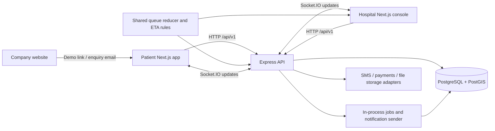

# MedLiveBD: project and business onboarding

Review date: 14 October 2026. This review starts from `origin/mvp` at
`cd2a676`, on the local branch `chore/local-runner`. The original checkout was
`main` at `99e4c5e`. No deployment or cloud database was changed during review.

Follow-up, 15 October: [flow and architecture audit](FLOW_ARCHITECTURE_AUDIT.md)
records new reproduced refund/OTP/session defects and their fix order. Passing
the queue canary should not be taken as approval of the whole production flow.

## 1. What you are being invited to join

MedLiveBD is a healthcare coordination platform for Bangladesh. Patients use a
Bangla-first web app; hospitals use staff consoles. Its central promise is that
reception calls the next patient and everyone waiting sees their updated serial
and estimated wait within two seconds (`NFR-01`).

The intended problem is operational uncertainty: patients travel and wait without
knowing when a doctor will actually see them; hospitals manage walk-ins, delays,
late arrivals, cancellations and empty slots; people looking for emergency care
cannot easily see which participating facility reports the relevant capability.
These are the product's stated problems, not independently validated market facts.

The core is real executable software with extensive tests, rather than a set of
mock screens. The public deployment is nevertheless a **demonstration**, using
synthetic hospitals and patients, simulated payments and logged SMS. The presence
of software does not establish paying customers, signed hospital contracts,
company registration, clinical approval, profitability or production readiness.

The intended business shape is a shared platform with hospital workspaces,
module entitlements and optional hospital-branded patient portals. The company
website introduces the product and directs hospital enquiries to email. Pricing,
subscription terms, revenue shares and commercial contracts are explicitly kept
outside this repository. Ask the founders for those documents; there is no basis
in the code for claiming a particular price or revenue model.

## 2. What is actually in the repository

| Area | Code and purpose | Important boundary |
|---|---|---|
| Patient app | `frontend/patient`: Next.js, discovery, booking, live serial, records, consent, beds, emergency and medicine discovery | Installable web app; native app-store releases and live push are not established |
| Staff console | `frontend/console`: reception, doctor, ward, ER, lab/pharmacy, settings, imports and administration | A hospital's workspace; demo picker differs from real staff authentication |
| Company website | `frontend/site`: Next.js, Bangla/English, hospital information, founder contacts, privacy and credits | Present on newer `mvp`; absent as a runnable app on the original `main`. No clinical API or patient database |
| API | `backend/api`: Express 5, Socket.IO, JWT, Kysely and PostgreSQL | Owns writes, permissions, queue state and provider adapters |
| Shared domain | `shared/domain`: queue events, reducer, ETA and business rules | Deterministic logic shared by server and console |
| Shared client/UI/i18n | `shared/client`, `shared/ui`, `shared/i18n` | Typed requests, realtime/offline clients, reusable components and translations |
| Database | `database`: SQL migrations, seeds, verification, API-role setup and tests | Forward migrations; synthetic seeds are separate from production setup |
| Worker package | `backend/workers` | Stub; it has no executable worker command and pg-boss is not installed |

Actual background work is started by `backend/api/src/server.ts`: hourly session
materialisation/cleanup, a notification sender, expiring queue offers and payment
holds. These are in-process loops with database-backed state. Do not add a separate
worker service merely because an older architecture document describes one.

Implemented areas include staff password login and administrator TOTP, patient
phone-code flows, guest links, queue operations and offline reconciliation,
hospital setup/onboarding, CSV and `.xlsx` import mapping/preview/approval/undo,
records and consent, bed operations, emergency/referral workflows, lab/pharmacy,
analytics and module/branding controls. Their existence does not mean every
workflow has passed a real hospital acceptance test.

The project is a coordination and workflow product, not a full hospital ERP:
payroll, HR, general accounting, insurance administration and PACS are outside its
declared scope. Diagnostic AI is not the product. The optional model integration
suggests import column mappings; a human confirms them and the existing checker
controls writes. It is designed to send headings/profiles rather than patient rows.

## 3. Architecture in plain language

This is a TypeScript pnpm monorepo and a modular backend, rather than a collection
of independently deployed microservices.



An API request follows `routes → controllers → services → repositories → db`.
Services decide what may happen; repositories perform database operations. Lint
rules enforce several of these boundaries.

The queue uses an append-only event log. A receptionist's action is recorded as
an event; the shared reducer derives the new queue state and ETA; the transaction
commits; the API broadcasts the result to connected devices. A current state
projection makes reads efficient; the log preserves the history and replay path.
Session locks order concurrent actions. Client event IDs make a replayed offline
action idempotent, so retrying a tap should not call another patient.

The staff console can draw an optimistic result and persist pending actions for
reconciliation after reconnecting. Offline capability is specific to supported
staff operations; it does not mean every app feature works without the server.
Live figures carry freshness information. An unknown or stale bed count must not
be presented as confirmed availability.

Multi-hospital access is controlled by both application permissions and database
row-level security. Request scope travels through AsyncLocalStorage to the database
connection: hospital, patient, guest, national, open or system. Production uses a
limited API role separate from the schema/backup owner. This launcher creates a
limited `healthcare_local_api` role too: migrations/seeds use the owner, while the
running API uses the limited role. Production permission tests also use limited
roles. An ordinary local run alone does not prove tenant isolation.

The intended V1 deployment is one API instance. Sockets, some coordination and
loops are process-local. Multiple instances need deliberate shared realtime,
coordination and rate-limit design; adding replicas is not a configuration-only
scaling change.

## 4. How the product should work

1. A platform administrator reviews a hospital's application and creates or
   approves its workspace. Hospital staff configure departments, doctors,
   schedules, fees, modules, capabilities and beds; publication follows approval.
2. A patient searches by specialty, doctor, hospital or care capability and sees
   participating facilities with the age of their operational figures.
3. They choose a doctor's session and book. Online, telephone and walk-in bookings
   join the same chamber's serial pool. A guest receives a signed tracking link.
   Real phone verification requires functioning SMS delivery; the demo simulates it.
4. Reception checks patients in, calls next, handles late/no-show cases and records
   delays. Those actions reach the patient's live serial screen through Socket.IO.
5. A clinician completes the visit and records the relevant information. Patients
   access their own records; cross-hospital clinical access requires the applicable
   consent/referral rules. Platform administrators should not browse patient records.
6. Ward, ER, lab and pharmacy staff update their own workflows. Only approved
   public operational information contributes to network discovery.
7. Background loops send/retry messages, expire offers/payment holds and create
   scheduled sessions. Administrators monitor usage and operational health.

To understand the central value, use two browser windows: book from the patient
app, open its tracking link, choose the matching chamber in the demo console and
tap Next. Watch the patient's serial change. Then try a delay and a cancellation.
Use synthetic information only, including in the public demo.

## 5. Run everything locally

From PowerShell in `V:\STARTUP\HealthCare`:

```powershell
.\run.ps1
```

If your shell blocks local scripts:

```powershell
powershell -NoProfile -ExecutionPolicy Bypass -File .\run.ps1
```

The launcher obtains the pinned pnpm through Corepack, installs the lockfile,
creates `.env` with independent random development secrets, starts a local
database, applies migrations, seeds only when there are no facilities, verifies
the schema, creates a separate limited API role, starts all four runnable apps
and waits for HTTP readiness.
It refuses a remote/production target and keeps existing demo data on later runs.
It does not download real SMS/payment credentials, which require provider accounts.

| Service | Local address |
|---|---|
| Patient | http://localhost:3000 |
| Staff console | http://localhost:3100 |
| API health/readiness | http://localhost:4000/healthz and /readyz |
| Company website | http://localhost:3200/en or /bn |

```powershell
.\run.ps1 -Background       # return after startup; leave apps running
.\run.ps1 -Stop             # stop only this launcher's apps; keep database/data
.\run.ps1 -SetupOnly        # dependencies, environment, migrations and seed only
.\run.ps1 -SkipInstall      # faster subsequent startup
.\run.ps1 -DatabaseProvider Docker
.\run.ps1 -DatabaseProvider WSL
.\run.ps1 -DatabaseProvider Existing
corepack pnpm dev:all        # package-script alias on Windows
```

Database selection prefers a working Docker engine, otherwise an existing Ubuntu
WSL distribution. WSL setup installs PostgreSQL 16, PostGIS and PostgreSQL contrib
packages; creates `healthcare_dev`, `healthcare_test`, `healthcare_api_test`; and
keeps existing databases. The development role/password `healthcare/healthcare`
matches the original Docker setup. The WSL database is under
`/var/lib/postgresql/16/main`, not inside the Git checkout. Database startup may
need separate troubleshooting if a different local PostgreSQL already occupies 5432.

This machine uses Node 24.19.0 and Corepack-managed pnpm 12.4.2. Application
dependencies live in the workspaces' `node_modules`, with pnpm's store at
`V:\.pnpm-store\v11`; runtime settings live in ignored `.env`. There is no Python
backend or Python virtual environment to populate. `.local/` holds ignored logs
and process state. Inspect `api.error.log`, `patient.error.log`, `console.error.log`
and `site.error.log` there if startup fails.

The launcher keeps a hidden WSL client open because WSL otherwise stops PostgreSQL
when its last Windows client exits. This stays open across app restarts; shutting
down Ubuntu WSL stops the database without deleting its data.

Ctrl+C stops the apps during a foreground run. PostgreSQL remains available.
`-Stop` also keeps database data. If you deliberately need a fresh local pitch,
stop the apps and run `corepack pnpm db:reset` before starting again; that command
destroys and rebuilds the local demo data and is not part of ordinary startup.
Browser suites also rebuild local demo data: run them while the launcher is stopped.

## 6. Deployments, CI and CD

These publicly accessible endpoints returned HTTP 200 during this review:

| Component | Address / provider | What was established |
|---|---|---|
| Company site | https://medlivebd.com and https://www.medlivebd.com | Cloudflare response; site exists |
| Pages deployment | https://medlivebd.pages.dev | Cloudflare response; site exists |
| Patient demo | https://healthcare-patient-zeta.vercel.app | Page responds with MedLiveBD title |
| Console demo | https://healthcare-console.vercel.app | Page responds with MedLiveBD console title |
| API demo | https://healthcare-api-m9ke.onrender.com/healthz | API responds healthy |
| API readiness | https://healthcare-api-m9ke.onrender.com/readyz | DB reachable, schema 0063, four job loops timely at observation |

Deployment documentation identifies Supabase in Singapore as the demo database,
Render in Singapore as the API host, and Vercel as the two product-app hosts.
Database connectivity was observed through readiness; cloud dashboard settings,
account ownership, costs, region and backup configuration were not independently
inspected. The public readiness response had `backup.watched=false`: it does not
prove a monitored backup exists. Public HTTP checks do not prove full user flows.

`.github/workflows/ci.yml` is real GitHub Actions CI, triggered for pushes and PRs
to `main`/`mvp`. Three jobs cover:

- Type checking, lint, formatting, schema verification and unit/UI/API/schema tests.
- Builds, the two-device queue canary, browser workflows and built-console checks.
- Production-mode browser flows with demo mode disabled and a limited DB role.

The demo's CD is provider-managed deployment from `main` according to `render.yaml`
and the deployment guide. The Actions file does not itself deploy the product,
apply Supabase migrations or prove deployments wait for passing CI. Confirm branch
protection and provider deployment gates with the account owners.

The company website uses a separate **manual Cloudflare Pages release** script:
static export, preview upload, then an explicitly confirmed production upload with
a scoped token. It is not the same deployment path as the patient/console/API.
Latest `mvp` site changes are documented as pending release; the live site may differ.

`deploy/docker-compose.yml` and the multistage Dockerfile provide a separate
production stack: PostgreSQL/PostGIS, migration and role setup, compiled API,
patient/console, Caddy TLS, persistent files and scheduled backups with restore
verification and a required second location. The company website is not in this
clinical stack. Real patient hosting in Bangladesh is the owner's intended default;
the Singapore demo is not proof that real-patient hosting has been commissioned.

## 7. Findings that affect a joining decision

1. **There is substantial implementation, but integration activation remains
   external work.** SMS delivery/sender ID, payment merchant approval and sandbox
   verification, hospital agreements, Bangladesh hosting, HMS access and independent
   security testing require evidence outside Git. Adapters tested against stand-ins
   should not be sold as verified live integrations. Web push remains skipped.
2. **Latest CI is recorded as red.** The 12 October status names portal-install
   title failures, a patient burn-search failure and a failing Test step. This is
   a repository report, not a fresh GitHub dashboard inspection. Older status/test
   counts and the 2 October handover are historical; do not treat their fixed
   defects as current or their passing gates as current proof.
3. **The public demo identity guard is unresolved.** Latest status says arbitrary
   phone numbers entered through demo patient/staff routes can be stored in
   Supabase. The documented owner decision is an explicit synthetic-identity
   allowlist, across every affected route. A UI warning is insufficient. No such
   live patch was deployed by this review.
4. **Operational visibility is limited.** Health/readiness and backup scripts exist;
   an independently operated alerting/on-call service and observed recovery drills
   are not established here. The public demo does not watch backup age.
5. **Single-instance availability and scaling need a plan.** A stopped API stops
   its sockets and job loops. Demo hosting may cold-start; real queues need a
   service availability target, monitoring and a restart/recovery policy.
6. **Documents have drift.** Some comments still describe future work already
   built, and older handover findings are superseded. `main`, `mvp`, website and
   hosted database releases are separate moving parts. Treat current code and
   dated evidence as necessary checks against prose.

## 8. Questions to answer before accepting the business offer

Ask for concrete evidence, rather than a verbal assurance:

- What company exists, who owns the IP/repository/domain/cloud accounts, and what
  role, equity, salary, vesting and decision authority are offered to you?
- Which hospitals have signed, who will operate the consoles daily, and what did
  staff demonstrate in an actual workflow trial? Is there measured demand or revenue?
- Who owns support, provider approvals, hosting costs, security review and incidents?
  What is the budget and expected launch date?
- Can they show recent CI results and a release checklist, including the open
  demo-identity fix and proof of tenant/records access tests?
- Can they demonstrate a backup restore and explain how access survives a founder
  leaving? Who controls payment/SMS credentials and account recovery?
- What will hospitals sign concerning data, consent, publication of availability,
  support and commercial terms? These documents are outside the codebase.

These are due-diligence questions, not a legal assessment. Verify contracts and
applicable obligations with qualified advisers when reviewing the actual documents.

## 9. A practical onboarding order

1. Run the launcher and perform the two-window booking/Next demonstration.
2. Read `README.md`, `CLAUDE.md` §1 and the latest dated entries in `docs/STATUS.md`.
3. Read product scope in `docs/PRD.md` and screen journeys in `docs/APP_FLOW.md`.
4. Follow one queue write through `backend/api/src/services/queue.service.ts`,
   its repositories, `shared/domain/src/queue` and realtime emission. Read
   `e2e/two-device-queue.spec.ts` for the acceptance promise.
5. Review schema/RLS and `config/dbScope.ts`, authentication, consent and the
   limited role in `database/scripts/lib/role.ts`.
6. Explore hospital setup, import preview/undo and a hospital-branded portal.
7. Review `.github/workflows/ci.yml`, `docs/DEPLOY.md`, backup/restore scripts and
   the site-specific release README with the person who owns the cloud accounts.
8. Agree a first milestone using the open findings and commercial evidence above.
   A real pilot should test a specific hospital's operating workflow before broader
   promises about national coverage or production scale.

## 10. Verification from this review

Verified on this machine:

- Pinned dependency installation: 594 packages, all 12 workspaces installed. No
  application framework upgrade. Chromium was also installed for browser checks.
- Clean local migrations: 61 migration files applied, through schema 0063;
  seed creates six demonstration facilities, 40 doctors and 200 synthetic patients.
- Schema invariants hold; separate limited local API role created.
- All four services started and returned HTTP 200; API readiness reports DB and
  all four job loops ready.
- Workspace type checking, repository lint and formatting passed. Focused lint,
  formatting and Git whitespace checks for the final launcher changes also pass.
- Two-device queue browser suite: **5/5 passed**. Includes the under-two-second
  Next action, repeated queue movement, delay, freshness and network-loss behaviour.
- Full unit/UI/API/schema run: **7,301 passed, 10 failed**, across 154 files
  (150 passing files). Logs: `.local/tests.log`. This is not a green full gate.
- Investigated the failures: emergency/referral chronology constraints (7),
  queue delay timing (1), backup-age rounding (2). The Ubuntu PostgreSQL clock
  was measured roughly 4–6 seconds ahead of Windows Node. A temporary clock
  synchronization did not remain effective while Ubuntu NTP was active; focused
  rerun gave **63 passed, 9 failed** out of 72 tests (`.local/recheck.log`).
  Clock skew is a likely contributing cause, not proof that every failure is
  harmless. No constraints/tests were weakened, and the launcher does not change
  machine clock/NTP settings. Test/backend clock alignment remains unresolved.
- Fixed the startup defect: shared UI imported `tailwindcss` without declaring
  it. Added the already-used version as its dependency and updated the lockfile;
  patient/console no longer fail with missing-Tailwind HTTP 500 errors.

- Production builds: **passed** for shared compiled packages, compiled API,
  patient app, console and company website (`corepack pnpm build`).

The entire browser suite,
production-mode browser suite, deployment-container build/restore and independent
security assessment were not run in this review. Public HTTP/readiness checks
above used no authenticated dashboard access or write to hosted patient data.
